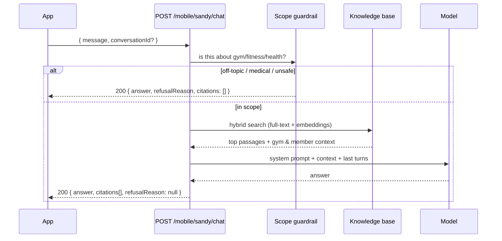

# Sandy AI — the gym assistant (mobile)

Sandy is an in-app chat that answers questions about **the gym, training,
exercise, nutrition and physical health** — and nothing else. All endpoints use
the **member** bearer token (`{{memberAccessToken}}`), same as the rest of
`/mobile/*`.

> Sandy is a *separate feature* from **Coach Chat**
> ([08-chat.md](08-chat.md)). Coach Chat is a real-time Socket.IO conversation
> with a **human** instructor. Sandy is a plain REST request/response with an
> AI. Don't wire them to the same screen or reuse the socket.

---

## 1. The flow



Nothing is streamed — one request, one complete answer. Show a typing indicator
while it's in flight; a normal answer takes roughly 1–4 seconds.

---

## 2. Endpoints

| Screen action | Endpoint |
| --- | --- |
| Send a message | `POST /mobile/sandy/chat` |
| Empty-state prompt chips | `GET /mobile/sandy/suggestions?lang=ar` |
| Chat history list | `GET /mobile/sandy/conversations` |
| Open a thread | `GET /mobile/sandy/conversations/:id/messages` |
| Rename a thread | `PATCH /mobile/sandy/conversations/:id` |
| Delete a thread | `DELETE /mobile/sandy/conversations/:id` |

### `POST /mobile/sandy/chat`

```jsonc
// request
{ "message": "كام جرام بروتين محتاج في اليوم؟", "conversationId": null }

// 200
{
  "conversationId": "clx...",   // save it — omit it only for the FIRST message
  "messageId": "clx...",
  "answer": "الكمية المناسبة حوالي 1.6 إلى 2.2 جرام لكل كيلو من وزن جسمك...",
  "citations": [
    { "docId": "clx...", "title": "How much protein you actually need",
      "sourceName": "Examine.com", "sourceUrl": "https://examine.com/..." }
  ],
  "refusalReason": null,
  "meta": { "model": "gpt-luna", "latencyMs": 812, "retrievedChunks": 4 }
}
```

**Sandy replies in the language the member wrote in** — Arabic question, Arabic
answer; English question, English answer. Don't send a language parameter and
don't translate client-side. This holds even though most source documents are
English.

`citations[]` are the sources behind the answer. Render them as tappable chips
under the bubble opening `sourceUrl` in a browser. The array is **empty on every
refusal** — guard your rendering on `citations?.length`.

Citations are deliberately narrower than what the model was given: only
documents scoring close to the best match are cited, capped at 4. So
`citations.length` is usually 1–3 and will often be smaller than
`meta.retrievedChunks` — that is correct, not a truncation bug.

---

## 3. Refusals are `200`, not errors ⚠

This is the single most important integration detail. When Sandy declines, the
HTTP status is still **`200`** and `answer` still contains friendly, useful text.
Only `refusalReason` is non-null.

| `refusalReason` | When | Suggested UI |
| --- | --- | --- |
| `OUT_OF_SCOPE` | Not about gym/fitness/nutrition/health | Normal bubble. Optionally re-show the suggestion chips. |
| `MEDICAL_ADVICE` | Diagnosis / prescription / treatment | Normal bubble + a "تواصل مع مدربك" button into Coach Chat. |
| `UNSAFE` | PEDs, starvation diets, disordered-eating patterns | Normal bubble, no extra CTA. |
| `PROVIDER_ERROR` | The AI provider is down or unconfigured | Bubble **plus** a retry affordance — this one is transient. |

Do **not** render refusals as red error states. `OUT_OF_SCOPE` in particular is
the expected, designed behaviour of the product, not a failure.

Real HTTP errors are the usual ones: `400` (empty or >2000-char message),
`401` (missing/expired token — refresh and retry), `404` (a `conversationId`
that isn't the caller's).

---

## 4. Conversations

`GET /mobile/sandy/conversations` → newest activity first:

```jsonc
[{ "id": "clx...", "title": "كام جرام بروتين محتاج في اليوم؟",
   "createdAt": "...", "lastMessageAt": "...", "messageCount": 6,
   "lastMessage": { "body": "...", "senderType": "ASSISTANT", "createdAt": "..." } }]
```

`title` is auto-derived from the member's first message (truncated). It is never
null after the first turn, so it's safe to render directly; `PATCH` lets the
member rename it.

`GET .../messages` is paginated **newest page first** (page 1 = most recent) —
the same convention as Coach Chat — but messages *within* a page are ordered
oldest→newest so a page renders top-to-bottom as-is. For infinite scroll:
render page 1, then prepend page 2 above it, and so on.

---

## 5. What Sandy knows about the member

Sandy is given the caller's own live context automatically — name, active
subscription and remaining days, assigned instructor, current workout
assignment, their submitted first-login onboarding answers (see
[07-onboarding.md](07-onboarding.md) — goals, injuries, training
preferences, whatever the dashboard currently asks), plus gym data
(branches, active packages, facilities, FAQs). So these all work without
the app passing anything extra:

- «فاضلي كام يوم في اشتراكي؟»
- «مين الكابتن بتاعي؟»
- «إيه الباقات المتاحة؟»
- «الفرع فين؟»
- «إيه اللي قولتهولك وقت التسجيل عن هدفي؟»

Sandy is told to answer gym-specific questions **only** from that live data, so
it won't invent prices or opening hours that aren't in the database.

---

## 6. Gotchas

1. **Refusals are `200`.** Repeated because it is the number-one thing to get
   wrong. Check `refusalReason`, not the status code.
2. **Omit `conversationId` only on the very first message**, then reuse the one
   that came back. Sending `null` on every message silently starts a new thread
   each time and the member loses all context.
3. **Only the last few turns are sent to the model** (`SANDY_HISTORY_TURNS`,
   default 4). A reference to something twenty messages back may not resolve.
4. **`citations` is empty on refusals** — guard before mapping over it.
5. **Sandy is not a doctor and is prompted to say so.** For anything clinical
   it will redirect to a professional. Don't try to prompt around it.
6. **Employee tokens get `401` here**, and member tokens get `401` on
   `/sandy-ai/*`. Two separate token families, as everywhere else in this API.
7. **`meta` is for debugging** (model, latency, chunk count) — don't show it in
   the member UI.

---

## Medical documents — Sandy reads files & remembers them

Members can hand Sandy a **lab result (PDF)** or an **X-ray / scan (image)** and
Sandy will read it, explain it in plain Jordanian Arabic, flag anything that
matters for training safety, and **always tell them to see a doctor**. It then
**remembers** it: the summary is stored privately on the member's profile and
Sandy factors it into future advice (e.g. it won't program heavy pressing while
a wrist injury is on file).

> **Private to the member.** These documents and their summaries are never shown
> on the dashboard — only the member and Sandy. There is no staff-facing view.

> **Not a diagnosis.** Sandy explains + warns + refers. For an X-ray it will say
> what the image *may* show and urge a doctor/ER — it will not declare "you have
> a fracture." Present its reply as guidance, not a medical verdict.

### The two-step flow

1. **Upload the file** with the existing `POST /mobile/uploads` (multipart
   `file`) → you get back a `url`.
2. **Send that URL** to `POST /mobile/sandy/documents`:
   ```json
   { "fileUrl": "<url from step 1>", "note": "وقعت على إيدي وبتوجعني", "lang": "ar", "conversationId": "clx… (optional)" }
   ```
   Response:
   ```json
   {
     "recordId": "clx…",
     "kind": "IMAGING",
     "title": "صورة أشعة لليد أو الرسغ",
     "reply": "…اشرح + حذّر + روح للدكتور…",
     "flags": [{ "severity": "high", "area": "اليد أو الرسغ", "note": "…" }],
     "trainingCaution": true,
     "meta": { "model": "…" }
   }
   ```
   Render `reply` as Sandy's chat bubble. If you pass `conversationId`, the
   upload + reply are also written into that thread, so the file "appears" in
   the chat history.

### Managing stored documents

| Method | Path | Purpose |
| --- | --- | --- |
| `GET` | `/mobile/sandy/documents` | The member's own stored docs (paginated) |
| `GET` | `/mobile/sandy/documents/:id` | One doc: summary, extracted facts, flags |
| `DELETE` | `/mobile/sandy/documents/:id` | Delete a doc and its memory |

A "My health files" screen can list these; deleting one removes it from Sandy's
memory too.

### Gotchas

- **Upload PDFs to a host that actually serves them.** Cloudinary (the default
  upload target) **blocks PDF delivery** unless the account enables *Settings →
  Security → "Allow delivery of PDF and ZIP files"*. Until then, PDF analysis
  fails with a fetch error; images are unaffected.
- **Scanned/photo PDFs** with no text layer are rejected — tell the member to
  upload them as an image instead (the vision path handles those).
- **`trainingCaution: true`** means Sandy advised pausing training of some area
  until a doctor clears it — a good cue to show a small warning banner.
- **Max 15 MB per file.**

---

## Streaming replies (SSE) — `POST /mobile/sandy/chat/stream`

For a live typing effect, use the streaming endpoint instead of `POST
/mobile/sandy/chat`. Same body (`{ message, conversationId? }`), same auth
(`{{memberAccessToken}}`), but the answer arrives token-by-token as
**Server-Sent Events** (`Content-Type: text/event-stream`).

**Frames** (each is an `event:` line + a `data:` JSON line, blank-line
separated):

| `event:` | `data` | What to do |
| --- | --- | --- |
| `delta` | `{ "text": "…" }` | Append `text` to the visible bubble. A refusal/error answer comes as **one** delta. |
| `done`  | `{ conversationId, messageId, citations, refusalReason, meta }` | Generation finished + persisted. Now render citation chips + the `refusalReason` badge. |
| `end`   | `{}` | Always last — stop reading. |
| `error` | `{ message, statusCode }` | Only if the stream couldn't start (e.g. a `conversationId` that isn't yours). No `delta`/`done` will come. |

**Client notes**

- **`citations` and `refusalReason` are only in `done`** — not on the deltas.
  Show the streamed text first, then decorate on `done`.
- **First delta can lag** a few seconds on a reasoning model (it reasons before
  emitting). Show a "typing…" indicator until the first `delta`.
- **Always 200 once open.** Don't rely on HTTP status for the foreign-thread
  case — branch on `event: error` instead.
- **Flutter:** use a streaming HTTP client (e.g. `http.Client().send(request)`
  and read `response.stream`), not `EventSource` — you need to send the bearer
  header and a POST body. Split the byte stream on `\n\n`, then parse each
  frame's `event:`/`data:` lines.
- The turn is persisted server-side exactly like the non-streamed `/chat`, so
  it appears in `GET /mobile/sandy/conversations/:id/messages` afterward.

---

## Message formatting — plain text with emoji sections (no Markdown)

Sandy's answers are written as **clean plain text**, not Markdown: emoji section
headers (e.g. `🍳 الفطور`, `💪 التمرين`, `📈 المتابعة`), `- ` bullets, blank
lines between short sections, and a few tasteful emojis. It deliberately does
**not** emit Markdown headings (`###`) or `**bold**`, because those render as
literal characters when the app shows the text as-is — so you can display
`answer` directly and it looks organized with no Markdown parser needed.

If you later add a Markdown renderer on the client, the output still renders
fine (the emoji headers and hyphen bullets are valid Markdown too) — but it is
**not required**. Render `answer` verbatim (RTL, `dir="auto"`) and it will look
like the meal-plan/checklist layout members expect.
